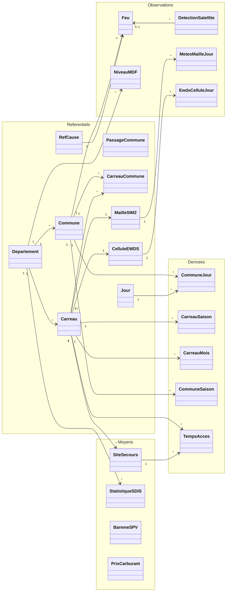
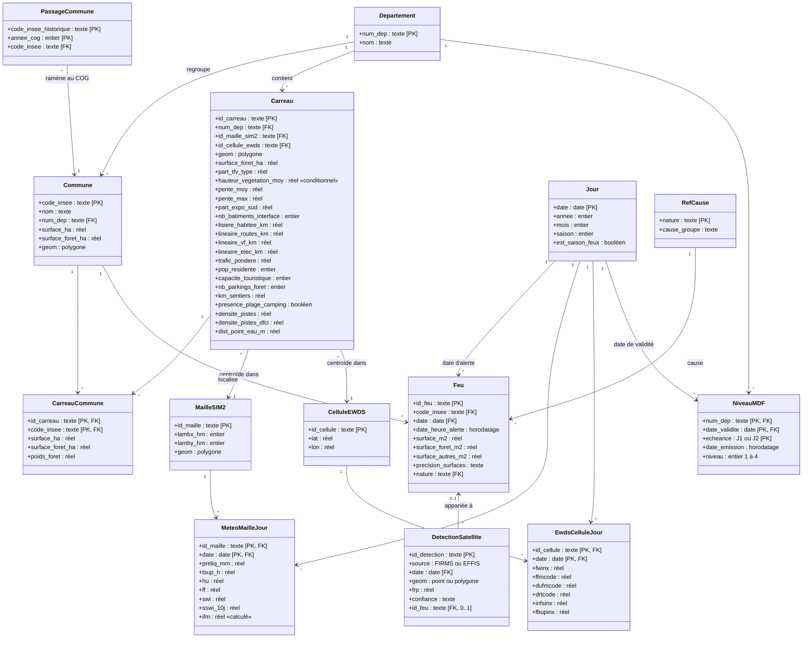
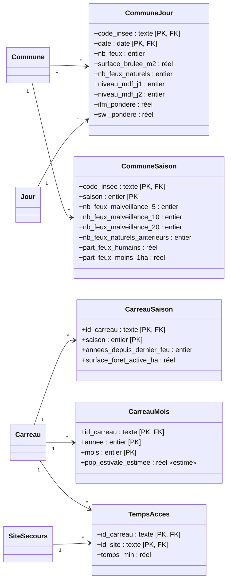
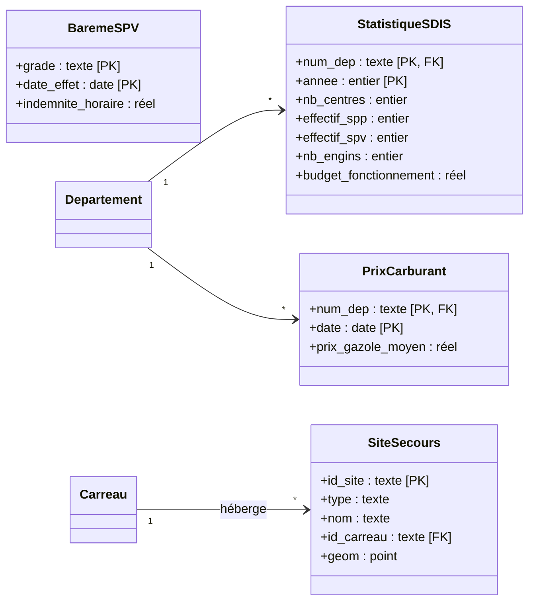

# UML de la super BDD : entrepôt feux de forêt SDIS 33

Ce document décrit **comment la base est constituée** : quelles tables elle contient, d'où vient chacune, avec quelles clés, et comment elles se relient. Emprise : Gironde (33), Landes (40) et Lot-et-Garonne (47).

Il s'appuie sur [`indicateurs-x-donnees.md`](../sources/indicateurs-x-donnees.md) (sources et statuts). Les diagrammes sont écrits en Mermaid : ils s'affichent dans GitHub, GitLab, VS Code (aperçu Markdown) ou sur [mermaid.live](https://mermaid.live).

---

## 1. Choix de modélisation

| Choix | Décision | Raison |
| ----- | -------- | ------ |
| Zone de référence | **Carreau DFCI de 2 km** (table `Carreau`) | Carroyage opérationnel des feux de forêt ; les données géographiques y sont agrégées une seule fois. |
| Rattachement des feux | **Commune** (table `Feu`, clé `code_insee`) | La BDIFF localise chaque feu à la commune, sans coordonnées. |
| Lien carreau ↔ commune | Table d'association `CarreauCommune` (surface et surface boisée de l'intersection) | Un carreau couvre plusieurs communes et inversement. |
| Météo | Stockée à sa **maille d'origine** (`MeteoMailleJour` pour SIM2, `EwdsCelluleJour` pour EWDS), reliée au carreau par une clé | Pas de duplication : environ 170 mailles SIM2 de 8 km couvrent la Gironde, contre environ 2 700 carreaux. |
| Météo des forêts | Table `NiveauMDF` au grain **département × date de validité × échéance** | Le niveau est publié par département ; J1 et J2 sont deux lignes. |
| Données qui changent dans le temps | Statiques dans `Carreau` et `Commune` ; datées dans `CarreauSaison`, `CarreauMois` et `CommuneSaison` | Évite de répéter les données statiques chaque jour. |
| Communes fusionnées | Table `PassageCommune` (table de passage du COG INSEE) | Les codes INSEE historiques de la BDIFF sont ramenés à un millésime unique. |
| Données non publiques | **Écartées du modèle** | Les données à demander au SDIS 33 et à Météo-France (interventions géolocalisées, impacts de foudre, disponibilité des moyens…) sont classées « écarté » dans [`indicateurs-x-donnees.md`](../sources/indicateurs-x-donnees.md). |

### Place dans l'architecture Médaillon

| Couche | Contenu | Exemples |
| ------ | ------- | -------- |
| **Bronze** | Fichiers bruts téléchargés, sans modification | `data/raw/bdiff/bdiff_33_40_47_2006_2025.csv`, `mdf_2024..2026.csv.gz`, `QUOT_SIM2_<année>.csv.gz`, couches IGN, fichiers INSEE |
| **Silver** | Une table propre par source, typée, avec des clés harmonisées (code INSEE ramené au COG, `num_dep` sur 2 caractères, dates locales, surfaces en m²) | `Feu`, `DetectionSatellite`, `MeteoMailleJour`, `EwdsCelluleJour`, `NiveauMDF`, `SiteSecours`, `StatistiqueSDIS`, référentiels |
| **Gold** | Tables dérivées, calculées à partir de la couche Silver | `Carreau` (attributs agrégés), `CommuneJour`, `CarreauSaison`, `CarreauMois`, `CommuneSaison`, `TempsAcces` |

---

## 2. Vue d'ensemble

Les classes sont regroupées en quatre paquets. Les attributs sont détaillés dans les diagrammes suivants.

---

## 3. Référentiels et observations (couche Silver)

**Règles d'alimentation**

| Classe | Source (Bronze) | Règle |
| ------ | --------------- | ----- |
| `Feu` | BDIFF | Code INSEE ramené au COG de référence par `PassageCommune` ; surfaces en m² ; heure d'alerte en heure locale. |
| `DetectionSatellite` | FIRMS, EFFIS | `id_feu` renseigné seulement pour les grands feux : même commune (+ 2 km), écart ≤ 24 h. |
| `MeteoMailleJour` | SIM2 | `LAMBX`, `LAMBY` (Lambert II étendu, hm) reprojetés pour créer `id_maille` ; `ifm` calculé à partir de `TSUP_H`, `HU`, `FF` et `PRELIQ` (approximation de l'IFM de midi). |
| `EwdsCelluleJour` | EWDS | Indices canadiens tels que publiés (noms courts NetCDF). |
| `NiveauMDF` | Archives MDF | Séparateur `,` ou `;`, `nom_dep` ou `dep_nom`, `1` ou `01` harmonisés ; `date_validite` = date d'émission + 1 (J1) ou + 2 (J2). |
| `Carreau` | DFCI, BD Forêt, BD TOPO, OSM, FILO, TOUR, RP, TMJA, BD ALTI, OLD | Agrégations spatiales par carreau ; surfaces boisées masquées par les surfaces brûlées EFFIS. |
| `CarreauCommune` | DFCI × ADMIN Express × BD Forêt | Intersection carreau × commune ; `poids_foret` = part de la forêt de la commune située dans le carreau. |
| `PassageCommune` | COG INSEE | Table de passage annuelle des communes (géographies 2003 à 2026). |

---

## 4. Tables dérivées (couche Gold)

**Règles de calcul**

| Attribut | Calcul |
| -------- | ------ |
| `CommuneJour.nb_feux`, `surface_brulee_m2`, `nb_feux_naturels` | Agrégation de `Feu` par commune et date d'alerte. |
| `CommuneJour.niveau_mdf_j1`, `niveau_mdf_j2` | `NiveauMDF` du département de la commune, à la date du jour. |
| `CommuneJour.ifm_pondere`, `swi_pondere` | Moyenne de `MeteoMailleJour` sur les carreaux de la commune, pondérée par `CarreauCommune.poids_foret`. |
| `CarreauSaison.annees_depuis_dernier_feu`, `surface_foret_active_ha` | Surfaces brûlées EFFIS datées, croisées avec la BD Forêt. |
| `CarreauMois.pop_estivale_estimee` | Résidents (FILO) + capacité touristique (TOUR, RP) × taux d'occupation supposé, répartis sur le bâti. |
| `CommuneSaison.*` | Comptages de `Feu` par commune sur les saisons antérieures à `saison` (5, 10 et 20 saisons). |
| `TempsAcces.temps_min` | Temps de trajet sur le graphe routier BD TOPO, du site de secours au centroïde du carreau. |

---

## 5. Moyens de secours (sources publiques)

**Sources**

| Classe | Source | Remarque |
| ------ | ------ | -------- |
| `SiteSecours` | BD TOPO (`nature` = « Caserne de pompiers »), OSM, points de rencontre ONF (PRS) | 74 casernes BD TOPO en Gironde. |
| `StatistiqueSDIS` | SNSDIS, balances comptables DGFiP | Grain département × année. |
| `BaremeSPV` | Arrêté des indemnités horaires des sapeurs-pompiers volontaires (Légifrance) | Une ligne par grade et par révision. |
| `PrixCarburant` | Prix des carburants (flux et historiques annuels) | Moyenne journalière du gazole par département. |

---

## 6. Volumes attendus (Gironde, Landes, Lot-et-Garonne)

| Classe | Grain | Ordre de grandeur |
| ------ | ----- | ----------------- |
| `Carreau` | carreau | ≈ 6 300 |
| `Commune` | commune | ≈ 1 200 (≈ 535 en Gironde) |
| `CarreauCommune` | carreau × commune | ≈ 15 000 |
| `Feu` | feu | 5 948 (2006 à 2025) |
| `MeteoMailleJour` | maille × jour | ≈ 400 mailles × 365 j × 20 ans ≈ 3 millions |
| `NiveauMDF` | département × jour × échéance | ≈ 2 200 (3 départements, 2024 à 2026) |
| `CommuneJour` | commune × jour de saison | ≈ 1 200 × 122 × 20 ≈ 3 millions |
| `SiteSecours` | site | quelques centaines |
