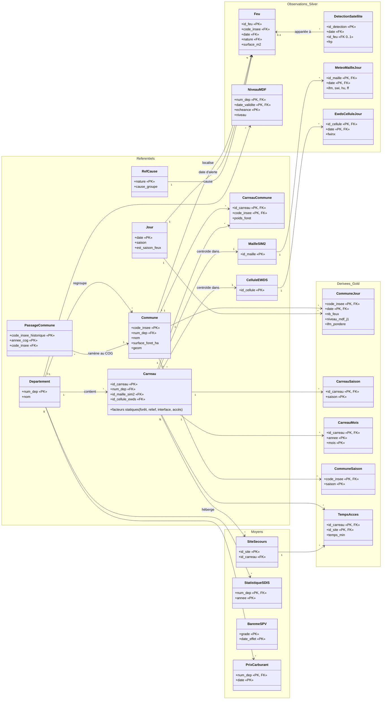

# Modèle de données : entrepôt feux de forêt SDIS 33

**Livrable du 20/11/2026** · Bloc « Qualité et modélisation des données » (HETIC, M2) · Équipe : voir le [README](../README.md#équipe)

**Problématique** : quel seuil d'un indice de risque, calculé par zone à partir de facteurs naturels et humains, permettrait au SDIS 33 de déclencher son dispositif renforcé à l'été 2027 de façon efficiente, tout en limitant les fausses alertes ?

**Emprise** : Gironde (33), avec les Landes (40) et le Lot-et-Garonne (47) en comparaison. **Double grain** : les facteurs sont calculés au **carreau DFCI de 2 km**, le seuil est évalué à la **commune × jour** (la BDIFF localise les feux à la commune).

Sommaire :
1. [Diagramme UML](#1-diagramme-uml)
2. [Des sources aux données cibles](#2-des-sources-aux-données-cibles)
3. [Alignement des données qui se chevauchent](#3-alignement-des-données-qui-se-chevauchent)
4. [Annexe : sources utilisées](#annexe--sources-utilisées)

---

## 1. Diagramme UML

Le modèle suit l'architecture **Médaillon** :

| Couche | Contenu |
| ------ | ------- |
| **Bronze** | Fichiers bruts téléchargés, sans modification (`data/raw/`, non versionné ; provenance dans [`data/README.md`](../data/README.md)). |
| **Silver** | Une table propre par source : types fixés, clés harmonisées (code INSEE ramené au COG, `num_dep` sur 2 caractères, dates en heure de Paris, géométries en Lambert 93). |
| **Gold** | Tables dérivées pour l'analyse : agrégats par commune × jour, par carreau × saison, temps d'accès des secours. |

Le diagramme ci-dessous montre les classes, leurs **clés** et leurs relations. Les attributs complets de chaque classe figurent dans [`docs/modelisation/uml-super-bdd.md`](../docs/modelisation/uml-super-bdd.md).

**Choix de modélisation principaux** (détail dans [`uml-super-bdd.md` § 1](../docs/modelisation/uml-super-bdd.md#1-choix-de-modélisation)) :
- La **météo reste à sa maille d'origine** (`MeteoMailleJour` pour SIM2, `EwdsCelluleJour` pour EWDS) et le carreau pointe vers sa maille : environ 170 mailles SIM2 couvrent la Gironde, contre environ 2 700 carreaux, ce qui évite de dupliquer les valeurs.
- `CarreauCommune` porte la **surface boisée de l'intersection** carreau × commune. C'est le poids qui sert à passer d'un grain à l'autre.
- `PassageCommune` ramène les **codes INSEE historiques** de la BDIFF (2006 à 2025) à un seul millésime du COG.
- Les données non publiques (interventions géolocalisées du SDIS, impacts de foudre…) sont **hors modèle** tant qu'elles ne sont pas fournies ([liste](../docs/sources/indicateurs-x-donnees.md#6-données-à-demander-au-sdis-33-et-aux-partenaires)).

---

## 2. Des sources aux données cibles

Pour chaque table cible : la source, le champ d'origine et la transformation appliquée entre Bronze et Silver (ou Silver et Gold). Les profils chiffrés viennent des fichiers déjà téléchargés (BDIFF, archives MDF) ; les autres sources sont décrites d'après leur documentation et seront vérifiées au premier chargement.

### 2.1. `Feu` ← BDIFF

Source : `data/raw/bdiff/bdiff_33_40_47_2006_2025.csv` (5 948 feux de forêt, 2006 à 2025, 767 communes). CSV UTF-8, séparateur `;`, **3 lignes de métadonnées avant l'en-tête**, 24 colonnes.

| Champ cible | Champ source | Transformation |
| ----------- | ------------ | -------------- |
| `id_feu` | `Année` + `Numéro` | Concaténation `AAAA-numéro`. `Numéro` seul **n'est pas unique** (il repart à chaque année) ; le couple l'est sur les 5 948 lignes. |
| `code_insee` | `Code INSEE` | Texte sur 5 caractères, puis ramené au COG de référence par `PassageCommune` (fusions de communes). |
| `date_heure_alerte` | `Date de première alerte` | Lecture `AAAA-MM-JJ hh:mm:ss` comme heure locale (Europe/Paris). |
| `date` | `Date de première alerte` | Partie date de l'horodatage local ; clé vers `Jour`. |
| `surface_m2` | `Surface parcourue (m2)` | Conversion en réel, unité conservée (m²). Toujours renseignée. |
| `surface_foret_m2` | `Surface forêt (m2)` | Idem. Contrôle : jamais supérieure à la surface parcourue (0 cas). |
| `surface_autres_m2` | `Surface parcourue (m2)` − `Surface forêt (m2)` | Champ calculé. |
| `precision_surfaces` | `Précision des surfaces` | `Estimées` ou `Mesurées` ; vide dans 81 % des cas → `Non renseignée`. |
| `nature` | `Nature` | Clé vers `RefCause`. Vide dans 56 % des cas → `Inconnue` (pas d'imputation). `RefCause.cause_groupe` sépare `Naturelle` des causes humaines (`Accidentelle`, `Involontaire (particulier)`, `Involontaire (travaux)`, `Malveillance`). |
| *(non repris)* | `Nom de la commune` | Le nom vient du référentiel `Commune` (voir § 3, les noms varient pour un même code). |
| *(non repris)* | `Type de peuplement` | Vide sur les 5 948 lignes. |
| *(non repris)* | `Décès…`, `Nombre de bâtiments…` | Hors périmètre de la problématique. |

### 2.2. `NiveauMDF` ← archives Météo des forêts

Source : `data/raw/archives/mdf_2024.csv.gz` à `mdf_2026.csv.gz` (96 départements par jour d'émission, saison estivale uniquement). Le schéma **change selon les années** (voir § 3).

| Champ cible | Champ source | Transformation |
| ----------- | ------------ | -------------- |
| `num_dep` | `num_dep` | Texte complété à 2 caractères (`1` → `01`) ; filtre sur `33`, `40`, `47`. |
| `date_emission` | `date` | Horodatage ISO en UTC (`…Z`) converti en heure de Paris (ex. `2024-06-04T16:00:00Z` → 18 h 00). |
| `echeance` | `niveau_j1`, `niveau_j2` | **Dépivotage** : une ligne source donne deux lignes cibles, `J1` et `J2`. |
| `date_validite` | `date` | Date locale d'émission + 1 jour (J1) ou + 2 jours (J2). C'est la date jointe à `Jour`. |
| `niveau` | `niveau_j1` ou `niveau_j2` | Entier de 1 (faible) à 4 (très élevé). |
| *(non repris)* | `nom_dep` / `dep_nom` | Le nom vient de `Departement`. |

En cas de réémission dans la journée, seule la dernière émission est conservée. Le J1 du jour et le J2 de la veille portent sur la même date de validité mais restent **deux lignes distinctes** (échéances différentes) : le J1 révise le J2 dans 3 à 12 % des cas.

### 2.3. `MeteoMailleJour` ← SIM2 (réanalyse Safran-Isba)

Source : `QUOT_SIM2_<année>.csv.gz` (séparateur `;`, un fichier par an, 8 981 mailles de 8 km en France).

| Champ cible | Champ source | Transformation |
| ----------- | ------------ | -------------- |
| `id_maille` | `LAMBX`, `LAMBY` | Identifiant créé par concaténation (le fichier n'a pas de numéro de maille). Coordonnées en **Lambert II étendu, en hectomètres** : × 100 pour passer en mètres, puis reprojection EPSG:27572 → EPSG:2154 (Lambert 93) pour construire `MailleSIM2.geom`. Filtre sur les mailles qui intersectent 33, 40 et 47. |
| `date` | `DATE` | `AAAAMMJJ` → date. |
| `preliq_mm` | `PRELIQ` | Cumul de pluie de 06 h à 06 h UTC, conservé tel quel. |
| `tsup_h`, `hu`, `ff` | `TSUP_H`, `HU`, `FF` | Maximum des températures horaires, humidité relative moyenne, vent moyen (moyennes de 00 h à 00 h UTC). |
| `swi`, `sswi_10j` | `SWI`, `SSWI_10J` | Humidité et sécheresse des sols, telles quelles. |
| `ifm` | `TSUP_H`, `HU`, `FF`, `PRELIQ` | **Calculé** : approximation de l'Indice Forêt Météo de midi (le jeu ne fournit pas l'IFM). |

### 2.4. Référentiels : `Commune`, `PassageCommune`, `Departement`, `Carreau`, `CarreauCommune`

| Table cible | Source(s) | Transformation |
| ----------- | --------- | -------------- |
| `Commune` | ADMIN Express (contours, code INSEE, nom officiel), BD Forêt | Millésime unique du COG pour toute la base. `surface_foret_ha` = intersection commune × BD Forêt (surfaces en ha). |
| `PassageCommune` | COG INSEE, table de passage annuelle (géographies 2003 à 2026) | Une ligne par code historique et par millésime, vers le code du millésime de référence. |
| `Departement` | ADMIN Express | `num_dep` sur 2 caractères. |
| `Carreau` | Carroyage DFCI 2 km (Lambert 93) + agrégations | Identifiant à 6 caractères (ex. `KD42F7`). `num_dep`, `id_maille_sim2`, `id_cellule_ewds` : couche qui contient le **centroïde** du carreau. Les facteurs statiques sont agrégés par carreau à partir de BD Forêt, BD TOPO, OSM, BD ALTI, FILO, TOUR, RP, TMJA et OLD ; les surfaces boisées sont masquées par les surfaces brûlées EFFIS. Règles détaillées dans [`uml-super-bdd.md` § 3](../docs/modelisation/uml-super-bdd.md#3-référentiels-et-observations-couche-silver). |
| `CarreauCommune` | DFCI × ADMIN Express × BD Forêt | Intersection carreau × commune ; `poids_foret` = part de la forêt de la commune située dans le carreau. |

### 2.5. Autres observations

| Table cible | Source(s) | Transformation |
| ----------- | --------- | -------------- |
| `DetectionSatellite` | FIRMS (points VIIRS et MODIS), EFFIS (contours) | Latitude et longitude WGS84 → point en Lambert 93 ; `acq_date` + `acq_time` (UTC) → date locale. `id_feu` n'est renseigné que pour les grands feux appariés à une fiche BDIFF : même commune (+ 2 km), écart ≤ 24 h. |
| `EwdsCelluleJour` | EWDS `cems-fire-historical-v1` (NetCDF, 0,25°) | Indices canadiens (`fwinx`, `ffmcode`, `dufmcode`, `drtcode`, `infsinx`, `fbupinx`) repris tels quels ; une cellule par point de grille. |
| `SiteSecours` | BD TOPO (`nature` = « Caserne de pompiers »), OSM, points de rencontre ONF | Dédoublonnage entre sources par proximité (voir § 3) ; rattachement au carreau qui contient le point. |
| `StatistiqueSDIS` | SNSDIS (PDF), balances comptables DGFiP | Extraction des tableaux PDF ; grain département × année. |
| `PrixCarburant` | Prix des carburants | Moyenne journalière du gazole des stations du département. |
| `BaremeSPV` | Arrêtés Légifrance | Saisie d'une ligne par grade et par révision. |

### 2.6. Tables dérivées (Gold)

| Table cible | Calcul à partir de la couche Silver |
| ----------- | ----------------------------------- |
| `CommuneJour` | `nb_feux`, `surface_brulee_m2`, `nb_feux_naturels` : agrégation de `Feu` par commune et date d'alerte. `niveau_mdf_j1`, `niveau_mdf_j2` : `NiveauMDF` du département de la commune à la date du jour. `ifm_pondere`, `swi_pondere` : moyenne de `MeteoMailleJour` sur les carreaux de la commune, pondérée par `CarreauCommune.poids_foret`. |
| `CommuneSaison` | Comptages de `Feu` sur les 5, 10 et 20 saisons **strictement antérieures** (pas de fuite d'information vers la saison évaluée). |
| `CarreauSaison` | Années depuis le dernier feu et surface boisée encore combustible (surfaces brûlées EFFIS × BD Forêt). |
| `CarreauMois` | Population estivale estimée : résidents (FILO) + capacité touristique (TOUR, RP) × taux d'occupation supposé. |
| `TempsAcces` | Temps de trajet sur le graphe routier BD TOPO, du site de secours au centroïde du carreau. |

---

## 3. Alignement des données qui se chevauchent

Plusieurs sources décrivent la même entité (une commune, un département, une date, un lieu) avec des écritures différentes. Le principe général : **on joint toujours sur une clé normalisée (code INSEE, `num_dep`, date locale, géométrie en Lambert 93), jamais sur un libellé.** Les libellés affichés viennent d'un seul référentiel.

### 3.1. Communes : noms, fusions, abréviations

| Problème | Exemples observés | Règle retenue |
| -------- | ----------------- | ------------- |
| **Un même code INSEE, plusieurs noms** dans la BDIFF (graphie corrigée au fil des années) | `40210` : `Onesse-et-Laharie` (2006-2015) puis `Onesse-Laharie` (2016-2023) ; `40295` : `Saugnacq-et-Muret` (2006-2022) puis `Saugnac-et-Muret` (2024-2025) | Jointure sur `code_insee` uniquement ; le nom affiché est celui du COG de référence. |
| **Fusions de communes** : le nom de la commune nouvelle remplace l'ancien | `33008` : `Arbis` (2010-2011) → `Porte-de-Benauge` (2023) ; `33018` : `Aubie-et-Espessas` → `Val de Virvée` ; `33268` : `Margaux` → `Margaux-Cantenac` ; `40197` : `Morcenx` → `Morcenx-la-Nouvelle` | Les codes des communes absorbées sont ramenés au code de la commune nouvelle par `PassageCommune` (table de passage du COG). Les feux anciens sont ainsi comptés sur le territoire actuel. |
| **Encodage cassé** | `33496` : `Sallebœuf` et `Salleb\x9cuf` (2016 : le `œ` a été décodé en Windows-1252) | Sans effet sur la jointure par code ; contrôle qualité : signaler tout libellé qui contient un caractère de contrôle. |
| **Abréviations et graphies** (« St » / « Saint », « Ste » / « Sainte », accents, casse, tirets) dans les sources qui n'ont **pas de code INSEE** (tableaux PDF, saisies manuelles, adresses OSM, codes postaux des stations-service) | `ST-MEDARD-EN-JALLES`, `St Médard en Jalles` et `Saint-Médard-en-Jalles` désignent la même commune `33449` | Clé de rapprochement normalisée : minuscules, sans accents, `œ` → `oe`, tirets et apostrophes → espace, `st` → `saint`, `ste` → `sainte`, espaces multiples réduits. On cherche la clé dans le COG **restreint au département** (des homonymes existent d'un département à l'autre), puis on garde le code INSEE. Un nom sans correspondance unique part dans une table de rejets à traiter à la main. |

### 3.2. Départements, schémas et formats

| Problème | Exemples observés | Règle retenue |
| -------- | ----------------- | ------------- |
| **Code département avec ou sans zéro** | MDF 2024 et 2025 : `1`, `2`… ; MDF 2026 : `01`, `02`… ; BDIFF : `"33"` entre guillemets | `num_dep` en texte sur 2 caractères, complété à gauche par `0` (texte et non entier, à cause de `2A` et `2B`). |
| **En-têtes différents** pour la même colonne | MDF 2024 et 2026 : `nom_dep` ; MDF 2025 : `dep_nom` | Table de correspondance des colonnes par millésime, appliquée au chargement ; la colonne n'est de toute façon pas reprise. |
| **Séparateurs différents** | MDF 2024 et 2025 : `,` ; MDF 2026 et BDIFF : `;` | Détection du séparateur à la lecture ; échec du chargement si l'en-tête attendu n'est pas retrouvé. |
| **Lignes de métadonnées** | BDIFF : 3 lignes de critères de sélection avant l'en-tête | Lecture à partir de la 4ᵉ ligne ; contrôle du nombre de lignes annoncé (« Nombre d'incendies… : 5948 »). |

### 3.3. Dates et fuseaux horaires

| Source | Écriture d'origine | Règle retenue |
| ------ | ------------------ | ------------- |
| BDIFF | `2006-02-05 12:31:00`, heure locale sans fuseau | Interprétée en Europe/Paris. |
| MDF | `2024-06-04T16:00:00Z` (UTC) ; émission vers 18 h en 2024, vers 16 h 50 en 2025 et 2026 | Convertie en Europe/Paris ; la jointure se fait sur la **date de validité** (+ 1 ou + 2 jours), pas sur la date d'émission. |
| FIRMS | `acq_date` + `acq_time` en UTC | Convertie en Europe/Paris avant d'en tirer la date (un passage de nuit vers 1 h 30 UTC tombe le même jour local, à 3 h 30). |
| SIM2 | `AAAAMMJJ` ; moyennes de 00 h à 00 h UTC, pluie de 06 h à 06 h UTC | Date conservée telle quelle ; le décalage de 2 h est documenté comme limite. |

Toutes les dates du modèle sont des dates calendaires locales, reliées à la dimension `Jour`.

### 3.4. Espace et unités

| Problème | Règle retenue |
| -------- | ------------- |
| **Projections différentes** : SIM2 en Lambert II étendu (hectomètres), DFCI et IGN en Lambert 93, FIRMS, EWDS et OSM en WGS84 | Toutes les géométries sont stockées en **Lambert 93 (EPSG:2154)**. |
| **Grains spatiaux différents** : feu à la commune, MDF au département, météo à la maille de 8 km ou 0,25°, facteurs au carreau de 2 km | Commune → carreau : poids de surface boisée (`CarreauCommune`). Département → carreau : la valeur est recopiée. Maille → carreau : maille qui contient le centroïde. Carreau → commune : moyenne pondérée par la surface boisée. |
| **Unités de surface** : m² dans la BDIFF, ha dans les référentiels | Surfaces des feux en **m²**, surfaces des référentiels en **ha** ; l'unité figure dans le nom de la colonne (`_m2`, `_ha`). |
| **Même objet dans plusieurs sources** : casernes BD TOPO et OSM, grand feu vu par FIRMS, EFFIS et la BDIFF | Casernes : fusion des points distants de moins de 200 m, priorité à la BD TOPO. Feux : la fiche BDIFF reste la référence, les détections satellite y sont rattachées par la règle commune + 2 km, ≤ 24 h. |

---

## Annexe : sources utilisées

Sources qui alimentent le modèle ci-dessus. Le catalogue complet (formats, grains, périodes, sources écartées et justification) est tenu à jour dans [`docs/sources/indicateurs-x-donnees.md` § 1](../docs/sources/indicateurs-x-donnees.md#1-catalogue-des-sources).

| Code | Jeu de données | Producteur | Tables alimentées | État | Lien |
| ---- | -------------- | ---------- | ----------------- | ---- | ---- |
| BDIFF | Base de données sur les incendies de forêt en France | Ministère de l'Agriculture, IGN | `Feu`, `RefCause` | Téléchargé (33, 40, 47 ; 2006-2025) | [bdiff.agriculture.gouv.fr](https://bdiff.agriculture.gouv.fr/incendies) |
| MDF | Météo des forêts : archives et API | Météo-France | `NiveauMDF` | Archives 2024-2026 téléchargées ; API testée (hors saison) | [data.gouv](https://www.data.gouv.fr/datasets/archives-de-la-meteo-des-forets) · [API](https://portail-api.meteofrance.fr/web/fr/api/DonneesPubliquesMeteoForets) |
| SIM2 | Données changement climatique, SIM quotidienne | Météo-France | `MailleSIM2`, `MeteoMailleJour` | En-tête et notice lus | [data.gouv](https://www.data.gouv.fr/datasets/donnees-changement-climatique-sim-quotidienne) |
| EWDS | Indices de danger feu historiques (`cems-fire-historical-v1`) | Copernicus (ECMWF) | `CelluleEWDS`, `EwdsCelluleJour` | À télécharger | [ewds.climate.copernicus.eu](https://ewds.climate.copernicus.eu/datasets/cems-fire-historical-v1) |
| FIRMS | Points chauds satellite (MODIS, VIIRS) | NASA | `DetectionSatellite` | À télécharger | [firms.modaps.eosdis.nasa.gov](https://firms.modaps.eosdis.nasa.gov/) |
| EFFIS | Surfaces brûlées, European Forest Fire Information System | Commission européenne (JRC) | `DetectionSatellite`, `CarreauSaison`, `Carreau` | À télécharger | [EFFIS](https://forest-fire.emergency.copernicus.eu/applications/data-and-services) |
| DFCI | Carroyage DFCI 2 km | IGN, DFCI | `Carreau` | À télécharger | [data.gouv](https://www.data.gouv.fr/datasets/carroyage-dfci-2-km/) |
| ADMIN | Admin Express (communes, départements) | IGN | `Commune`, `Departement`, `CarreauCommune` | À télécharger | [data.gouv](https://www.data.gouv.fr/datasets/admin-express/) |
| COG | Code officiel géographique : table de passage des communes | INSEE | `PassageCommune` | À télécharger | [insee.fr](https://www.insee.fr/fr/information/7671867) |
| BDFORET | BD Forêt® V2 | IGN | `Commune`, `Carreau`, `CarreauCommune`, `CarreauSaison` | Attributs lus (WFS) | [data.gouv](https://www.data.gouv.fr/datasets/bd-foret-r) |
| BDTOPO | BD TOPO® v3 | IGN | `Carreau`, `SiteSecours`, `TempsAcces` | Attributs lus (WFS) | [data.gouv](https://www.data.gouv.fr/datasets/bd-topo-r/) |
| OSM | OpenStreetMap France métropolitaine | OpenStreetMap | `Carreau`, `SiteSecours` | À télécharger | [data.gouv](https://www.data.gouv.fr/datasets/donnees-openstreetmap-integrales-de-france-metropolitaine/) |
| BDALTI | BD ALTI® 25 m | IGN | `Carreau` (pente, exposition) | À télécharger | [geoservices.ign.fr](https://geoservices.ign.fr/bdalti) |
| OLD | Obligations légales de débroussaillement | IGN, ministère de l'Agriculture | `Carreau` | À télécharger | [data.gouv](https://www.data.gouv.fr/datasets/debroussaillement) |
| TMJA | Trafic moyen journalier annuel, réseau routier national | Ministère de la Transition écologique | `Carreau` | À télécharger | [data.gouv](https://www.data.gouv.fr/datasets/trafic-moyen-journalier-annuel-sur-le-reseau-routier-national/) |
| FILO | Filosofi, données carroyées à 200 m | INSEE | `Carreau`, `CarreauMois` | À télécharger | [insee.fr](https://www.insee.fr/fr/statistiques?debut=0&theme=0&categorie=10&geo=0) |
| TOUR | Capacité d'hébergement touristique des communes | INSEE | `Carreau`, `CarreauMois` | À télécharger | [insee.fr](https://www.insee.fr/fr/statistiques/2021703) |
| RP | Recensement de la population : logements | INSEE | `Carreau`, `CarreauMois` | À télécharger | [insee.fr](https://www.insee.fr/fr/statistiques) |
| PRS | Points de rencontre des secours | ONF | `SiteSecours` | À télécharger | [data.gouv](https://www.data.gouv.fr/datasets/points-de-rencontre-des-secours-et-couverture-telephonique-1) |
| SNSDIS | Statistiques nationales des SDIS | DGSCGC | `StatistiqueSDIS` | À télécharger (lien officiel à confirmer) | [miroir](https://www.ressourcesdupompier.com/etudes-statistiques/) |
| BALANCES | Balances comptables des établissements publics locaux | DGFiP | `StatistiqueSDIS` | À télécharger | [data.gouv](https://www.data.gouv.fr/datasets/balances-comptables-des-etablissements-publics-locaux-depuis-2010/) |
| CARBU | Prix des carburants en France | Ministère de l'Économie | `PrixCarburant` | À télécharger | [data.gouv](https://www.data.gouv.fr/datasets/prix-des-carburants-en-france-flux-instantane/) |
| SPV | Indemnité horaire des sapeurs-pompiers volontaires | Légifrance | `BaremeSPV` | À saisir | [legifrance.gouv.fr](https://www.legifrance.gouv.fr/) |

**Sources écartées** (justification dans le catalogue) : BLITZ (licence), SUFOSAT (non diffusé), GASPAR, R500, CLC, S1 et FEST. Les autres jeux du catalogue (AROME, ARPEGE, ERA5, ISDIS, OCS GE, RPG…) ne sont pas utilisés par le modèle à ce stade.
